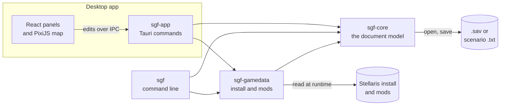
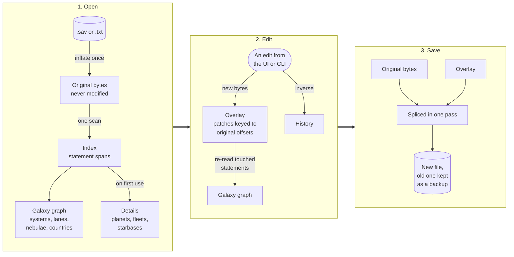
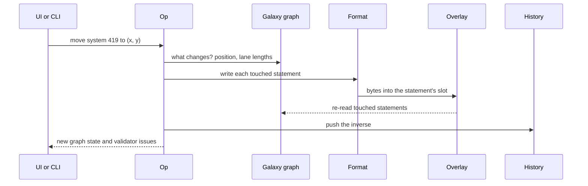

# Architecture

This page explains how Stellaris Galaxy Forge holds a document in memory
and how an edit gets from the map to the file. The README has the short
version. The rules every change follows are in
[engineering-rules.md](engineering-rules.md).

## The pieces



- `sgf-core` is the Rust core. It opens a save or a scenario, indexes
  it, projects the galaxy from it, applies edits and writes the file
  back. It has no idea a UI exists.
- `sgf-gamedata` reads the user's Stellaris install and active mods at
  runtime. That covers system initializers, star and planet classes,
  localisation, textures and the scripts that place things at game
  start. When a mod file changes, a file watcher rebuilds the registry
  it affects. It also rolls the systems added to a save from the
  install's own rules, reads what building a megastructure leaves in a
  system, and bakes the sprites the system view draws from the game's
  models.
- `sgf` is the command line. `sgf apply` runs the same edits from a
  terminal, as ops written in JSON files. It is also the test harness
  for the core.
- The desktop app is a Tauri 2 shell (`sgf-app`) around a React and
  TypeScript UI with a PixiJS map. The UI never touches bytes. It sends
  edits to the core over IPC and redraws from what comes back.

## Where things live

```
crates/
  sgf-core/        the document model
  sgf-gamedata/    the user's install and mods
  sgf-cli/         the sgf binary
app/
  src-tauri/       the Tauri shell
  src/             the React + TypeScript UI
docs/  scripts/  testdata/  workshop/  .github/  changelog.d/
```

The tables below go one level deeper. Each path is relative to the
folder in the table's heading.

### `crates/sgf-core/src`

The document model. It knows nothing about a UI.

| Path | What's in it |
| --- | --- |
| **Reading the file** | |
| `archive.rs` | The `.sav` zip: inflates `gamestate` and `meta`, and writes backup-then-persist |
| `document.rs` | A loaded document (original bytes, index, overlay), and whether it is a save or a scenario |
| `scan.rs` | The index, built in one pass: the span of every statement and id-keyed block |
| `lexer.rs` | Tokens: bare and quoted scalars, braces, equals |
| `cst.rs` | A concrete syntax tree for the statements an edit has to read |
| `span.rs` | Byte ranges |
| `keys.rs` | The statement keys the formats read |
| **Editing** | |
| `session/` | Holds the document, graph and history. `file.rs` opens and saves, `edit.rs` applies, undoes and redoes, and the rest answer the reads the shell and CLI ask for. `Session::save(query)` hands out the save-only queries in `save.rs` (a system's construction site, where planets can move, copying and pasting planets, the op that adds a ring world, what clearing one takes) and refuses them for a scenario or a save before 4.0, naming the query |
| `ops/` | Every edit. `op.rs` has the `Op` enum, and `Op::reach` gives each op the document kinds that take it and how its details go stale. The planners under `format/*/write` build each op's edits, description and inverse. `edit.rs` is what they plan in, `plan.rs` commits all of an op's edits or none of them, and `error.rs` holds the refusals. `rules/` decides what an edit may do to the graph. `history.rs` puts bytes back for undo. `Created` lists the systems, planets and megastructure rows an op added, read from its inverse unless the writer lists more |
| `overlay.rs` | Patches keyed to original offsets: replace a span or insert at one |
| `emit/` | Writes the bytes of an edited statement, copying its indentation. `megastructure.rs` writes a `megastructures` row and the bypass it stands for |
| `format/` | The `Format` trait. `save/` and `scenario/` are the only per-format code. `save/details/` projects a system's planets, fleets and starbase. `save/write/` writes the save ops, and `game_tables.rs` holds what is copied from the game's files. `save/site.rs` reads the bodies of a system with their classes, deposits, modifiers and flags as a `ConstructionSite`, which gamedata replays a build chain against. `save/ring_world.rs` says which bodies and rows make up a ring world. `save/planet_extras.rs`, `abundance.rs` and `dig_sites.rs` read what other tables of a save say of a planet |
| **Reading the galaxy back** | |
| `projections/` | Caches read from the index: the galaxy graph and names, the readers they share, and `geometry.rs`, where a system's bodies stand about their parents |
| `entity/` | Finds any entity in the file for the inspector |
| `search.rs`, `search/` | Finds systems and entities by name or id, and systems by what they hold. `search/star_types.rs` finds the star classes a galaxy has |
| `validate/` | Checks for what the game could not cope with. `paint.rs` and `scenario.rs` hold the checks that apply to only one kind of file |
| `guides.rs` | Where the game places things at generation (the L-Cluster circle) |
| **Other files** | |
| `prepare/` | Preparing a scenario for a new game: the rows its systems sort into, the choices each row offers, the presets, and the one batch that writes a set of choices. Which systems stand in each row is sgf-gamedata's `prepare.rs` |
| `export/` | Writes a save's galaxy out as a scenario, as a draft with a report. `policy.rs` decides what is kept. `paint/` adds the Paint a Galaxy header, seats and fallen empire zones |
| `backup.rs` | The backups beside a saved file: the original, the three newest and four spread over the rest |
| `library.rs` | Where this machine keeps its saves, and what each campaign folder holds, for the Open screen |
| **Tooling** | |
| `views.rs` | The IPC types. ts-rs exports them to `app/src/generated` |
| `shape.rs` | Every key path of a gamestate with its count, and the difference between two |
| `synth.rs` | Synthetic saves for stress tests |
| `../tests/` | Each op applied to the sample saves and snapshotted with insta, the round trip, corpus timing, and `constants.rs`, which writes `app/src/generated/constants.ts` |

### `crates/sgf-gamedata/src`

The user's install and mods, read at runtime.

| Path | What's in it |
| --- | --- |
| **Finding the files** | |
| `install/` | Finds Steam, the install and the mods (Paint a Galaxy by its Workshop id), and works out load order and overrides. `layers.rs` is the one `Layout` of vanilla and mod layers that every reader goes through. `script.rs` parses definition folders and keeps the last definition of a key, except in the two first-wins folders. `walk.rs` is the one walk over an effect block. `inline_script.rs` reads `inline_script` calls |
| `lib.rs` | `GameData`, with every registry behind an `Arc`. `GameData::read` loads them, and `GameData::derive` works out the ones read from other registries: the megastructure types and the marked planet classes |
| `reload.rs` | Rereads only the registry a changed file belongs to. `RegistryKind` names the kinds |
| `mod_compatibility/` | The one place that names a mod: the megastructure families the add dialog holds back, the shader tables of the model baker, and the Workshop items the app links to |
| **Definitions** | |
| `registries/` | Star and planet classes, colours, deposits, resources, ship sizes, starbase levels, country types, bypasses, galaxy sizes and shapes, defines, gfx, graphical cultures, section templates and scripted triggers. `terraform_links.rs` says which modifier makes a planet a terraforming candidate |
| `registries/megastructure*.rs` | The megastructure types. `megastructures.rs` reads each type with where it is placed, `megastructure_families.rs` links the stages, ruins, ring worlds and gateways, `megastructure_swaps.rs` reads what a finished stage turns into, and `megastructure_offers.rs` decides which types the add dialog offers |
| `loc/` | Localisation files and language-keyed names |
| `textures/` | DDS decoding, the sprite cache, and the planet and star discs the system view draws (`sphere.rs`, `planet_disc.rs`, `star_disc.rs`, `shatter.rs`). `model/` bakes a megastructure's or starbase's model into a sprite |
| `fonts.rs` | The typeface the map writes empire names in |
| `initializers.rs` | `solar_system_initializers`: what a system will spawn |
| `scripts/` | Events, effects and on_actions: who claims what on day one |
| `special.rs` | Leviathans, enclaves, marauders, fallen empires, landmarks |
| `condition.rs` | A trigger block compiled to the conditions the crate can judge. A `Subject` judges them, and what it cannot answer is unknown |
| `weight.rs` | A weight block: a base, its factors and its modifiers |
| **Megastructures** | |
| `construction.rs` | What a type's build chain leaves, as steps on the system, its owner, the body it is built at or the system's planets, with the effects it could not place listed beside them |
| `construction/` | `replay.rs` replays a chain against a `ConstructionSite`. `layout.rs` reads the rows and planets a finished stage spawns and removes. `habitat.rs` and `ring_world.rs` turn a layout into the planets and rows the core adds |
| `dismantle.rs` | What a type's `on_dismantle_complete` takes back |
| `generate/megastructure.rs` | Builds the op that adds a megastructure, a habitat or a ring world to a save, and says which types go at a spot and why the save would refuse the others |
| `megastructure_views.rs` | The types as the add dialog shows them, with their effects and the picture of the game's construction card |
| **Reading what an initializer places** | |
| `structures.rs`, `structure_spawns.rs` | The megastructures and starbase an initializer places, in the shape a save's rows have |
| `stated.rs` | What an initializer block states beyond its bodies, and every statement the reader does not model |
| `spawn_rolls.rs`, `rolls.rs`, `feature_roll.rs` | What the game can roll for each body of a scenario system: the class, the ring, the deposits and the planet features |
| **Rolling a system for Add system** | |
| `generate/` | Rolls a system from the install's rules, with `rng.rs` for its random numbers. `save.rs` builds the bodies and systems added to a save, and the class rules a class change takes |
| `picks.rs` | The classes the Add system and Add body menus offer |
| `orbit_walk.rs` | Places each planet and moon of an initializer as the engine does. The roller, the example roll and the scenario details all use it |
| `layouts.rs` | The `misc_system_init` layouts the generator can build |
| `deposit_roll.rs` | The deposits a generated body rolls |
| `body_effects.rs` | What a layout's `init_effect` does to a body it places |
| `naming.rs` | Names for the systems and nebulae the editor places |
| `menu.rs` | The Special menu of Add system |
| `summary.rs` | The hover card of an Add system pick |
| **What the panels show** | |
| `details.rs` | A scenario system's details from its initializer, the example roll the system view shows, and each save body's star class and whether it is a moon |
| `planet_views.rs` | What the planet page shows from the install |
| `choices.rs`, `*_choices.rs`, `planet_models.rs` | The planet the page's pickers ask about, and what each offers to add: anomalies, deposits, dig sites, modifiers and models |
| `prepare.rs` | Which row of Prepare for a new game each system of a scenario stands in |
| `report.rs` | What `sgf gamedata --report` lists: what the install and the mods define that the editor cannot show, draw, add or follow |
| `resolver.rs` | Gives details and exports the install's definitions when game data is loaded. Without game data they use the save's own keys |
| `views/` | The IPC types, one file per family of registries |
| `../tests/` | Tests against a fixture mod in `tests/fixtures`, and against the real install when there is one |

### `crates/sgf-cli`

The `sgf` binary. `cli.rs` declares it, and `commands/` has one file per
verb. `apply.rs` runs the edits that JSON files hold.

### `app/src-tauri`

The Tauri 2 shell, `sgf-app`.

| Path | What's in it |
| --- | --- |
| `src/commands/mod.rs` | What the command modules share: running a closure over the open session off the caller's thread (`with_session`, `with_open`, `with_open_mut`), `require`, which refuses a command when the open document's `Capabilities` lack what it needs, and `game_data`, which refuses one that needs game data when none is loaded. Also the event names and `fit_to_game_data`, which sizes the open session by the loaded defines |
| `src/commands/session.rs` | Opening, reloading, editing, undoing and saving the one open document, exporting a scenario, and checking the file on disk |
| `src/commands/listing.rs` | The save, campaign and scenario listings |
| `src/commands/entity.rs` | Reading the open document: a system, one entity, search, where a save's planets can move, and copies of them to paste |
| `src/commands/scenario.rs` | What the loaded scripts say about a scenario's systems: owners, bypasses, details and rolls |
| `src/commands/gamedata.rs` | Loading the install's game data, and serving what the loaded data holds, textures included |
| `src/commands/add_system.rs`, `add_body.rs`, `nebula.rs` | Rolling a system, a planet or a moon, and placing a nebula |
| `src/commands/add_megastructure.rs`, `add_habitat.rs`, `add_ring_world.rs`, `megastructure_fits.rs` | The megastructure adds and the list of types that go at a spot. Each calls the join in sgf-gamedata's `generate/megastructure.rs` and applies the op it returns |
| `src/commands/megastructure.rs` | Deleting a megastructure with what its dismantle takes back, and a ring world with the flags each ring leaves |
| `src/commands/prepare.rs` | Preparing the open scenario for a new game |
| `src/commands/paint.rs` | A Paint a Galaxy scenario's fallen empire zones and header counts |
| `src/commands/editors.rs` | Opening script files in the user's editor, and the app's links in the browser |
| `src/commands/update.rs` | The updater |
| `src/editors/` | Which text editors this machine has, and how each opens a file at a line |
| `src/state.rs` | The open session, game data and texture cache behind mutexes. Game data carries a generation that counts every load and accepted rebuild |
| `src/views.rs` | The shell's own IPC types: the answers of the adds, Prepare's preview and edit, the updater, and the document watcher's report |
| `src/watch/` | Watches the install and mod roots game data was read from (`mod.rs`, `guard.rs`), and the open document's folder (`document.rs`) |
| `tests/` | The commands end to end on the sample save. `constants.rs` writes `app/src/generated/shell.ts`: the event names and the releases and guide URLs |

### `app/src`

React and TypeScript. The folders are layers, listed from the top. A
layer imports only from the layers below it. `lib/README.md` and
`panels/README.md` state the rule and its exceptions.

| Path | What's in it |
| --- | --- |
| `panels/` | The React tree: `chrome/` (top bar, dock, status bar), `inspector/`, `browser/` (empires, points of interest, issues, changes), `file/` (Open screen, New scenario), `initializers/`, `search/`, `overlays/` (the dialogs, among them the Add megastructure dialog and its ring world and planet change picks, and the megastructure browser) |
| `map/` | The PixiJS renderer. `MapController` runs the ticker and handles resize, the wheel and the pan keys for whichever scene is showing. `GalaxyScene` has the galaxy's camera, layers and bindings. `tilt.ts` and `drawnPositions.ts` say where the lean of the galaxy plane and the heights put each system, and every galaxy layer draws through them |
| `map/interaction/` | The Select and brush models, and `pointerBridge.ts`, which feeds both scenes their input |
| `map/layers/` | The galaxy map's layers, one file each. `highlights/` has the brush, drag and symmetry overlays |
| `map/picking/` | What lies under the pointer |
| `map/system/` | The system view. `sources.ts` reads one `SceneSubject` (the system's details, roll, node and neighbours) for either kind of document, and `context.ts` turns it into what the layers draw. `picking.ts` names what lies under the pointer as one `SceneTarget`. `bodyDrag.ts` and `drags.ts` hold the drags. `camera.ts` fits the view to the system. `structures.ts` and `structureKinds.ts` say what a megastructure or a starbase is drawn from and what a click, a menu and a drag do with it. `layers/` has bodies, structures, orbits, belts, labels, radii, exits, handles, locks, wormholes, nebula, the highlight and the rolled placeholders |
| `store/` | Zustand stores, one per concern: session, editor, galaxy, game data and so on |
| `store/editorStore.*.ts` | The editor's actions, split by subject (nebulae, lanes, brush, ...) |
| `store/editorEdits.ts` | The queue every edit runs through. `symmetricEdits.ts` widens an edit under symmetry |
| `store/fileSessionStore.*.ts` | `saveGate.ts` asks the questions before a save. `writes.ts` writes the files |
| `store/planetEditAdapter.ts` | Chooses the row of body edits for the document's kind and applies it to a body. `planetEditAdapter.save.ts` holds the save's row, the ops a save body's page sends. `systemGeometry.ts` applies a system's geometry edits, and `resetScopes.ts` says which stores a closed document or reloaded game data resets |
| `store/megastructureAdd.ts`, `megastructureRemoval.ts`, `ringWorldRemoval.ts`, `prepareStore.ts`, `modelPrewarm.ts` | The megastructure adds and deletions, and the Prepare flow. `modelPrewarm.ts` asks for the models of a document's structures in the background once the save and the game data are both in, so the system view finds them baked |
| `lib/` | Pure helpers over the generated types: `geometry/`, `initializer/`, `details/`, `visual/`, `brush/`, `keys.ts`. `lib/README.md` says what each holds |
| `api/` | One function per Tauri command, one file per module of `src-tauri/src/commands`, all re-exported by `ipc.ts` |
| `generated/` | ts-rs output, `constants.ts` and `shell.ts`. `cargo test --workspace` rewrites it, so don't edit it by hand |
| `test/` | Builders and stand-ins the tests of every layer share, and `ipc.ts`, the one set of command spies. `setup.ts` mocks the dialog plugin once for every test file, and `README.md` says how to open a document in a test. `store/storeFixture.ts` resets every store for a test |

### The rest of the repository

| Path | What's in it |
| --- | --- |
| `Cargo.toml` | The workspace: `crates/*` and `app/src-tauri` |
| `VERSION` | The version number. `scripts/version.sh` copies it into the manifests |
| `CHANGELOG.md`, `changelog.d/` | Keep a Changelog. Each PR adds a file to `changelog.d/`, and the release folds them into `CHANGELOG.md` |
| `docs/` | This file, the user guide, the engineering rules, the format and game-data facts, the Paint a Galaxy notes, `adr/`, `media/` |
| `scripts/` | `version.sh`, `changelog.sh` and `docs-only.sh` for the workflows, and `game-update.sh` for a new game version |
| `testdata/` | The 3.4, 4.4 and 4.5 sample saves (git-lfs), the 4.4 save's scenario and Paint exports, a scenario as Paint a Galaxy writes one, the Issues fixtures, a grammar fixture and two add-system specs |
| `workshop/` | The Steam Workshop page, and the uploader that pushes it to Steam (its own Cargo package) |
| `.github/` | `ci.yml` runs the checks on three OSes. `ci-docs.yml` reports them as passed for a docs-only change. `release.yml` tags, builds and publishes. Also `changelog.yml`, `actions/setup`, and the PR template with the in-game checks |

## What a session holds



A save is a zip with two members, `gamestate` and `meta`. A scenario is
a plain text file. The session inflates or reads the text once and keeps
those original bytes unchanged for as long as it is open.

The index comes from one linear pass over the text. It records the byte
span of every top-level statement. Inside the sections that hold
entities, it also records the span of every id-keyed block. Structure
comes from counting braces. The game writes keys at column 0 at any
depth, so indentation means nothing. The index is the only structure
the editor keeps about the file as a whole, apart from what the
document caches beside it. A save keeps its `nebula` sections and the
systems, planets, deposits, dig sites and wormholes an op added, both read
back from the overlay after every edit. It also keeps the countries that
have found each planet's anomaly and what clearing each blocker costs,
read on first use. The index of an inner section (`planets.planet`,
`starbase_mgr.starbases`, `archaeological_sites`) is built the first time
an address needs it. A scenario keeps its own index of the statements it
reads. The `meta` bytes of a save are held beside the original, with the
version an op rewrote. There is no typed model of the file, and nothing is
ever serialised from one.

The galaxy graph is a projection read from the index. It holds systems
with their positions and lanes, nebulae with their members, and
countries with the systems they own. The details projection covers
planets, deposits, fleets, starbases and archaeological sites. It is
built the first time something asks for it. Both projections are
caches. An edit updates or invalidates them, and they are never written
back.

Every edit writes its replacement bytes into the overlay. A replacement
is keyed to the offset, in the original, of the statement it replaces.
A new statement is keyed to the offset it is inserted at, plus a
sequence number. Each statement has one slot, and a later edit to the
same statement replaces what is in it. The original bytes are never
modified.

When an edit is applied, the history records the edit, a description
for the change log, its inverse, and the slot contents the edit
replaced. Undo puts those old bytes back, and redo puts the edit's bytes
back. A `Batch` applies several edits
as one history entry. If any of them is refused, the document is left as
it was.

An op is a variant of `Op`. Its row from `Op::reach` says which document
kinds take it, whether it leaves the details projection stale and how that
is brought up to date (read again in place, or built again), whether it
reclassifies systems, whether it needs a 4.x save, and whether it takes a
second step once the first is committed. The format's planner for the op
decides its edits, its description and its inverse, in terms of the
primitive in `ops/edit.rs`. `ops/plan.rs` commits the edits together, and
`ops/error.rs` holds the reasons an op is refused. The session refuses
from outside an op that is only ever an inverse.

## An edit, end to end



1. The UI or the CLI sends an edit: move system 419 to (x, y).
2. The core decides what changes on the galaxy graph. Here that is the
   system's position, and the stored length of each of its lanes on
   both ends.
3. The format writes the bytes for each touched statement and puts them
   in the overlay. Emitted text copies the indentation of the statement
   it replaces.
4. The graph re-reads the touched statements, so the map and the
   inspector show the new state.
5. The inverse (move it back, restore the lengths) goes onto the
   history.
6. The validator runs over the graph and reports what the game could not
   cope with.

On save, the core streams the original bytes from start to end into a
new file beside the old one. Where an overlay slot replaces a span, the
slot's bytes go out instead of the original ones. An inserted statement
goes out at its insertion offset. The old file is then renamed to
`<name>.sav.bak-<stamp>` and the new one is moved into place.

## When the file changes on disk

The open document is watched. The session notes the file's length and
modification time when it opens the file and again after each save. The
shell watches the file's folder, and checks again when the window gets
focus back. A change that doesn't match the stamp reloads a scenario
with no unsaved edits, keeping the view: the camera, the tilt, the
hidden empires and the selection where the file still holds it.
Everything read from the old bytes is reset. Prepare keeps its choices
and reads its preview again. With unsaved edits, or for a save, the app
asks: Reload reads the file again and clears undo history; Keep my
changes leaves both. The app's own saves update the stamp under the
session lock, so they never reload.

Save still checks: if Stellaris (or anything else) has written the file
since, a save in place refuses with `changed_on_disk` and the app asks.
Overwrite saves again with `force`, and the backup-then-persist path
renames the other version aside as the backup; Save As picks another
file; Cancel writes nothing. A save to a different path is not checked,
because the file dialog already asked about overwriting it.

Game data is watched too: a change under a loaded root rereads the
registries its folder feeds, each through its loader over the whole
layout, so override and `replace_path` rules hold as in a full load.

## Ownership

Who owns a system comes from three places. `sgf-core` reads the
structure written in the text. In a save, that is the countries and
the systems they hold. In a scenario, it is the marauder roles and
fallen empire zones, read from the initializers and flags the scenario
names. `sgf-gamedata` works out what that text means at game start: the
scripted owners and day-one claims that its initializer chains and
events hand out.

In the app, `composeOwnership` in `lib/ownership.ts` merges the two into
a single owner table. A scenario's marauder clan (a home and the raid
bases hyperlaned to it) becomes one synthetic owner in that table, and
the scripted marauder country behind it is dropped. A single map layer
paints every owner in the table.

## Scenario profiles

A scenario is written for a profile. `Plain` is the game's own static
galaxy script. `PaintAGalaxy` is the same script decorated for Oatmeal
Problem's mod. The export builds a plain draft, and `export/paint`
decorates it with the mod's header, a spawn script on every seat, the
fallen empire zones and the wormhole flags.

Reading a scenario needs no profile. The scenario format picks out the
mod's statements from the bytes (`format/scenario/paint.rs`,
`fe_zone.rs`), so the editor keeps them in a scenario another tool
wrote for the mod.

In the app, `lib/paint.ts` decides whether a document is a Paint one. It
goes by the file's content, the choice made when the file was created,
and where the file is. `store/paintModStore.ts` holds the standing
choice and the mod's install state. `sgf-gamedata` finds the mod itself
(`install/mods.rs`).

## The format seam

A save and a scenario share the byte model, the index, the graph, the
edits and the history. What differs between them is behind the `Format`
trait. It says which statements hold systems, lanes and nebulae, which
edits the format supports, and how each edit's bytes are written. Each
op's row in `Op::reach` says which kinds take it. A scenario can add and
remove any system and set what it spawns. A save can add systems and
remove the ones added this session. It can also edit its bodies: star
classes, planet sizes, classes and models, orbits and belts, moons, deposits,
modifiers, anomalies and dig sites. It can delete planets and moons,
remove colonies, move a planet to another system, move wormholes, add and
remove wormhole pairs, set system heights, and change an empire's name,
flag and map colours. It can add a megastructure of any type the install
defines, a habitat as a planet, or a whole ring world, move a
megastructure within its system, and delete megastructures and ring
worlds. A save stores lane lengths, and a scenario does not.
An edit decides what changes on the graph, and the format writes the bytes.

The planet page is one `BodyPage` for every kind of document. A
`BodySource` for each kind reads the body and the rows its page lists, and
gives the page the adapter that edits it. A system's geometry is edited
through one adapter per kind too, and `lib/documentKinds.ts` holds the other
things that differ between kinds as one row each. The scene reads a system
through one `SceneSubject`, and the system view's drags go through one
`SceneTarget`. `app/src/lib/README.md` and `app/src/panels/README.md` say
which module holds what.

## Megastructures

An add that needs the install is built in `sgf-gamedata`, not in the
shell. `generate::megastructure_op`, `habitat_op` and `ring_world_op`
take the game data and the session, read the system through
`Session::save`, and return the `Op` with the effects of the build that
the op does not write, as unsure or unwritten. The shell's command
checks the document's capability, calls the function and applies the
op. `megastructure_fits` builds the same ops for each type and asks the
session whether it would refuse them, so the Add megastructure dialog
shows the core's own refusals.

What a build leaves in a system comes from the install. `construction.rs`
reads a type's build chain into steps, `construction/replay.rs` replays
them against the system as the save holds it, and the result rides on
the op as a `MegastructureConstruction`: timed modifiers, deposits and
owner variables. `construction/layout.rs` reads the rows and planets a
finished stage spawns, which `habitat.rs` and `ring_world.rs` turn into
`AddHabitat` and `AddRingWorld`. [ADR 0008](adr/0008-construction-model.md)
says what is replayed and what is only listed.

The document keeps the construction of a row added this session beside
the row, so `RemoveMegastructure` takes it back with the row. A row the
file held goes with `DeleteMegastructure`, which takes back what the
install says its dismantle removes. `DeleteRingWorld` clears the flags
`GameData::ring_flags` lays out for each ring size. `lay_out_rings`
assumes the rings were built nearest the star first, each on the section
flags the earlier rings took, so two rings built in another order can
leave a section flag behind when one is deleted while the other stands.
Without game data a megastructure is deleted with nothing taken back, and
a ring world delete clears the base game's flags.

The core names no mod. It learns which megastructure types make up a ring
world from the loaded install (`RingWorldTypes`, set by the shell), and
`sgf-gamedata/src/mod_compatibility/` is the one place that holds facts
about particular mods.

The system view draws a megastructure or a starbase from a sprite baked
from the game's model, in a save and in a scenario.
[ADR 0007](adr/0007-baked-model-sprites.md) says why.
