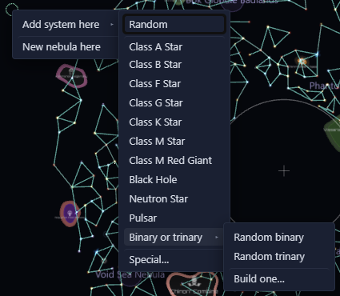
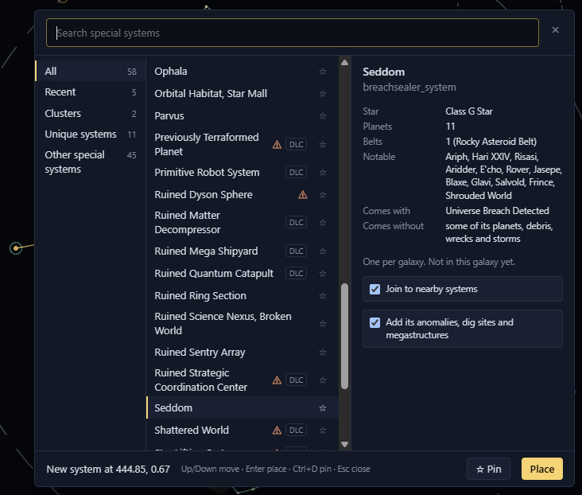
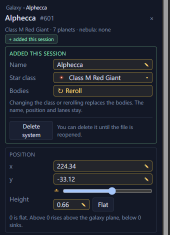

# Add and delete systems <Badge type="tip" text="Save" /> <Badge type="info" text="Scenario" />

Right-click empty space on the map to add a system. The menu offers
different choices in a save and in a scenario.

## Add a system to a save <Badge type="tip" text="Save" />

Right-click empty space and select "Add system here", then Random or a
star class. Hover an entry to see its star, planets, belts and notable
bodies.

A system added inside a nebula joins it. To add many systems at once,
draw a [shape](shapes.md#in-a-save).

## Add a special system <Badge type="tip" text="Save" /> <Badge type="info" text="Scenario" />

Right-click empty space in a save and select "Add system here", then
"Special…". A list of the game's special systems opens beside the spot,
with the map left in view. Type in the search field to find one by name.

The list has these groups:

- Pinned and Recent. Press <kbd>Ctrl</kbd>+<kbd>D</kbd> or the star on a
  row to pin it.
- Clusters, such as the Junk Ratlings, which the game places as a group.
  Each row shows how many members it has.
- Unique systems, such as Zevox and Sol.
- Other special systems, such as Trappist.
- One group for each mod that adds special systems.

Some rows show a mark:

- A warning mark means the galaxy already has that system and the game
  normally places only one. You can still add another.
- A DLC tag names the DLC the system belongs to.
- A lock means the save doesn't have the DLC the system belongs to. You
  can still add the system, but its events won't run.

The pane on the right shows the highlighted system's star, planets,
belts and notable bodies. Press Place or <kbd>Enter</kbd>, or
double-click a row, to add it at the spot. If the spot is too close to
another system, the pane says so and Place is greyed out.

A cluster adds all its members and the lanes between them as one edit,
with its first member at the spot. The map shows where each one would
go, and the pane lists them. Press Shuffle to roll their places again.
A member that can't go where it was rolled shows red and the pane says
why. Place stays greyed out until a shuffle or another spot works.

"Join to nearby systems" lays lanes from what you add to its
neighbours, as a shape's New and nearby lanes do, so it isn't left as
an island. The map shows those lanes before you place. Untick it to add
it with no lanes to the rest of the galaxy. The picker remembers your
choice.

A cluster's first system is also in the list on its own. Added alone,
its events look for the rest of its cluster, which isn't there. The
pane says so.

A special system comes with its own anomalies and dig sites, as the game
gives them. The pane lists them under "Comes with", and what the system
lacks under "Comes without". To add the system without them, untick "Add
its anomalies, dig sites and megastructures". The picker remembers your
choice.

A special system built round a ruined megastructure, such as a ruined
Dyson Sphere or ring world, comes with its ruins too. Untick the same
checkbox to add the system without them.

Some of what the game gives a special system is missing:

- Empires, colonies and pre-FTL civilisations. Sol's Earth, for example,
  is an uncolonised continental world.
- Fleets and guardians, and any starbase.
- An anomaly or dig site the script puts on a planet it picks at random, or
  a dig site on a star.
- Debris, wrecks and storms.
- Planets the game's script spawns there, such as Seddom's
  Huanghun. The pane lists these as "some of its planets".

If the galaxy already has the system, the game's events about it stay with
the one that is there. The pane says so.

In a scenario, right-click empty space and select "New special
system…". The same picker opens, with the clusters too. The game builds
each system from its initializer when the galaxy is made, so there is
no option to leave anything out and no "Comes with" or "Comes without"
list. A DLC shows as a tag only: the game you start decides. The game
also names the systems, so the pane lists a cluster's systems by their
initializers.

## Systems outside the galaxy edge

In a save, you can add systems past the galaxy edge, out to half again
the galaxy's radius. The game puts some systems past the edge itself,
such as the L-Cluster's. The map still draws the edge at the galaxy's
radius.

Add system here and the Shape tool both stop at that limit. Further out,
Add system here is greyed out with the reason under it, and a shape
leaves those points out. You can still move a system further out once
it is added.

In a scenario, the Shape tool reaches half again past the map's square,
out to 750 on every side.

## Reroll an added system <Badge type="tip" text="Save" />

Reroll on an added system's page rolls new planets around the same
star. For a special system, it builds that system again. Picking a different star class there rolls a regular system
around that star. The name, position and lanes stay.

<Annotated :marks="[
  { n: 1, box: [8, 119, 330, 24], label: 'Name' },
  { n: 2, box: [8, 145, 330, 24], label: 'Star class' },
  { n: 3, box: [8, 171, 330, 24], label: 'Reroll the bodies' },
  { n: 4, box: [8, 242, 95, 42], label: 'Delete system' },
  { n: 5, box: [8, 304, 330, 160], label: 'Position and height' }
]">

</Annotated>

## Rename a system

In a save, you can rename a system you added this session. Type a new
name in the Name field on its page. Its star and planets take the new
name.

In a scenario, you can rename any system. Type into the name at the top
of its page. A system with no name shows "Random name", and Stellaris
picks one when the game starts.

## Add a system to a scenario <Badge type="info" text="Scenario" />

Right-click empty space to add a system. "New system from…" adds one
that spawns from the [initializer](../scenario/initializers.md) you pick.
To add many at once, use the [Paint systems brush](brushes.md#paint-and-erase-systems).

## Delete systems

In a save, you can delete only the systems you added since you opened
the file. To delete one, select it and press
<kbd>Delete</kbd>, or right-click it and select "Delete system". To
delete several, select them, right-click one and select "Delete N added
systems".
Systems the save already had can't be deleted.

In a scenario, select systems and press <kbd>Delete</kbd> to remove
them.
