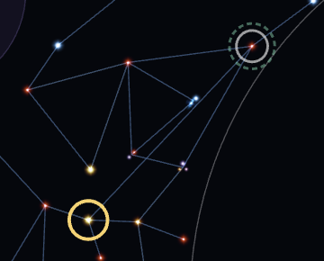
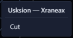
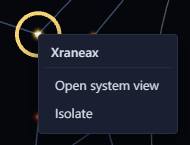

# Hyperlanes <Badge type="tip" text="Save" /> <Badge type="info" text="Scenario" />

Hyperlanes join systems. You can draw them one at a time, in broad
strokes with a [brush](brushes.md), or between every system you select.

## Draw a hyperlane

Zoom in until a ring appears around a star, then drag from the ring to
another system. <kbd>Shift</kbd>+drag from the star works at any zoom.

## Cut a hyperlane

Hover a lane and click the "×" at its middle. Right-click a system and
select "Isolate" to remove all its lanes.

Right-clicking a lane also offers Cut.

## Link or cut several systems at once

With two or more systems selected, the Inspector's Hyperlanes section can
add lanes between them or cut them. It has an Add lanes block and a
Remove lanes block.

In Add lanes, the Link choice sets which lanes the button adds. Every
pair links each selected system to every other one, and works on up to 5
systems. Nearby connects each system to the systems near it, so it suits
a large selection. Its Density slider sets how many lanes it adds. The
left end lays the fewest lanes, and the new lanes form no loops of their
own. At the right end, each system links to every neighbour. Like the game is
ticked by default. It links the selection in small clusters joined by
single lanes, as the game does. Untick it for an even spread of lanes.
Point at the "Add N lanes" button to preview the new lanes on the map.

Remove lanes has "Cut lanes between them" and "Isolate them". Cut lanes
removes only the lanes that join two selected systems. Isolate removes
every lane from each selected system, including lanes to systems outside
the selection. Each button shows how many lanes or systems it changes.

The right-click menu on a selected system has the same actions: "Link
every pair", "Link nearby", "Cut lanes between them" and "Isolate them".
Each shows a count in brackets.

## Join a split galaxy

When the galaxy is in separate pieces, click "Join" beside Components
in the Inspector. It connects the pieces with the shortest hyperlanes
that don't cross any others.

## Reset a lane's length <Badge type="tip" text="Save" />

The game uses a hyperlane's stored length as its travel cost. A lane's
page marks the length with "!" when it doesn't match the distance
between its systems. Click "Reset length" on the lane's page, or right-click
the lane and select "Reset length". Either sets the length to that
distance. With several systems selected, "Reset lane lengths" in the
Inspector's Hyperlanes section resets the lanes of those systems whose length is off.

## Prevent a lane <Badge type="info" text="Scenario" />

Right-click a hyperlane and select "Cut and prevent" so the game never
generates it. Right-click a prevented lane and select "Allow" to undo
that.
