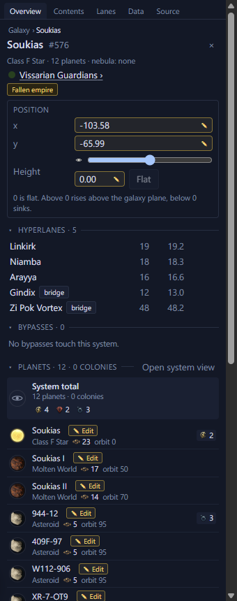

# Select and move systems <Badge type="tip" text="Save" /> <Badge type="info" text="Scenario" />

Most edits start by selecting systems.

## Select systems

Click a system to select it. <kbd>Ctrl</kbd>+click adds or removes one,
and dragging on empty space draws a selection box. <kbd>Esc</kbd> clears
the selection.

## Move a system

Drag a star to move it. If it is part of a selection, the whole
selection moves. <kbd>Shift</kbd>+arrow nudges the selection. For an
exact position, type coordinates into the Position fields on the
Inspector's Overview tab. A moved system keeps its hyperlanes and their lengths are updated.
Its planets and fleets move with it.

You can move a system past the galaxy edge, as far out as you like. To
add new systems out there, see
[Systems outside the galaxy edge](add-systems.md#systems-outside-the-galaxy-edge).

## Rotate a selection

To turn a group of systems, select two or more. A round handle appears
above them on the map. Drag it to turn the selection about its centre.
Hold <kbd>Shift</kbd> to snap the turn to 15°. To turn about another
point, drag the pivot marker there first. Once you have moved it, the
Pivot row in the Inspector's Position section reads "moved", and its
**Centre** link puts the pivot back.

For an exact turn, open the Rotate block in the Inspector's Position
section. Type an angle in the Degrees field and press <kbd>Enter</kbd> or
click **Rotate**, or use the Quick buttons: 90° left, 90° right and 180°.
A positive angle turns clockwise. The typed angle stays in the field, so
you can apply it again.

Nebulae centred inside the selection turn with it. Untick **Nebulae too**
to leave them where they are. Each turn is one undo step.

To remove systems, see [Delete systems](add-systems.md#delete-systems).
