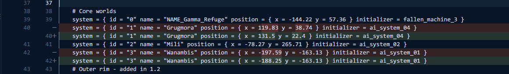
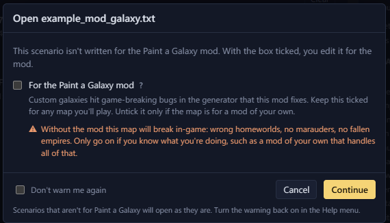
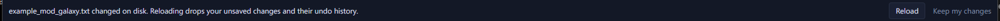
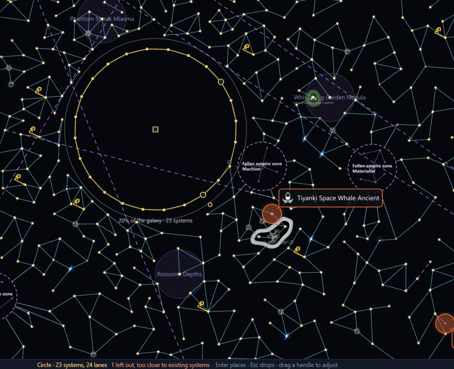

# For mod authors <Badge type="info" text="Scenario" />

This page is for authors of total conversions and map mods who write
`map/setup_scenarios/*.txt` by hand. Open your mod's scenario in Galaxy
Forge to move, add and delete systems, rework hyperlanes and assign
initializers on the map. Write initializers in your text editor as before.

## Your comments and formatting stay

Galaxy Forge rewrites only the lines your edits touch. Every other byte
of the file is copied as it was.

- Comments, blank lines, key order and formatting stay as you wrote them.
- Keys Galaxy Forge doesn't know stay too.
- Opening and saving with no edits writes the same bytes. A test checks
  this on a set of real scenarios.
- A new line copies the indentation of the lines around it.
- Undo and redo put back the exact bytes.

After a save, `git diff` shows only the lines your edits touched.

## Edit a plain scenario without Paint a Galaxy

If you open a scenario that isn't written for Paint a Galaxy, Galaxy Forge
asks whether to edit it for the
[Paint a Galaxy mod](paint-a-galaxy.md). For your own mod, answer no:

1. On the Open screen, click "Browse…" and pick the scenario in your
   mod's folder or git checkout.
2. Untick "For the Paint a Galaxy mod". The warning under the box
   says to go on only for a mod of your own that handles homeworlds,
   marauders and fallen empires.
3. Tick "Don't warn me again" if you don't want the question next time.
4. Click Continue.

Galaxy Forge remembers the box on this computer, for new scenarios too.
With the box unticked, your edits are written as a plain scenario that
doesn't need Paint a Galaxy.

With the box ticked, opening and saving still write nothing on their
own. Your edits are written for Paint a Galaxy instead. For example, a
new system with a spawn weight gets the mod's spawn script.

A bar under the top bar suggests saving the map into Paint a Galaxy.
Click "Not for me" to hide it for good.

A file that Galaxy Forge or Paint a Galaxy didn't make gets no
`# created by` line from a save.

## Work beside your text editor

You can have the scenario open in Galaxy Forge and in your text editor
at the same time. [Save, back up and restore](../safety/saving.md#when-the-file-changes-on-disk)
has the details.

- After you save in your text editor, a scenario with no unsaved edits
  in Galaxy Forge reloads by itself.
- With unsaved edits, a bar offers "Reload" and "Keep my changes".

  

- Save asks before it writes over a file that changed on disk.
  "Overwrite" backs up the other version first.
- Rows on the Scripts tab and spawn rows open the scenario in your
  text editor at their line. While you have unsaved edits, it opens at
  the top.
  [Open a script in your editor](initializers.md#open-a-script-in-your-editor)
  says how to pick the editor.

Each save leaves a backup beside the file, named
`<name>.txt.bak-<date>-<time>`, and up to eight are kept. In a git
checkout they land in `map/setup_scenarios`. Add `*.bak-*` to your
`.gitignore`. Galaxy Forge's own Open list skips them.

## Rework a big map

- [Delete systems](../edit/add-systems.md#delete-systems): select
  them and press <kbd>Delete</kbd>.
- Clear an area with the
  [Erase brush](../edit/brushes.md#paint-and-erase-systems) or by
  [erasing with a shape](../edit/shapes.md#erase-with-a-shape).
- Fill an area with the Paint brush, [shapes](../edit/shapes.md) and
  [symmetry](../edit/brushes.md#use-symmetry).
- [Rotate a selection](../edit/select-and-move.md#rotate-a-selection)
  or [swap two systems](../edit/select-and-move.md#swap-two-systems).
- Link a selection with "Link every pair" or "Link nearby", or cut it
  loose with "Isolate them". See
  [Link or cut several systems at once](../edit/hyperlanes.md#link-or-cut-several-systems-at-once).
- [Join a split galaxy](../edit/hyperlanes.md#join-a-split-galaxy) with
  the shortest lanes that cross no others.
- Mark lanes the game must never generate with
  ["Cut and prevent"](../edit/hyperlanes.md#prevent-a-lane).
- [Assign one initializer](initializers.md#choose-a-systems-initializer)
  to every selected system.
- Type an initializer's key into [search](../map/search.md) to find the
  systems that use it. The
  [Initializer keys layer](../map/layers.md#every-layer) shows each
  system's initializer on the map.

## Initializers from your mod

Galaxy Forge reads initializers from the game and from the mods enabled
in your launcher playset. It doesn't read the mod your scenario is in
unless that mod is enabled. Enable it, start Stellaris once with the
playset, then click Reload in the
[Game data panel](../start/game-data.md#check-what-it-loaded).

- A mod whose descriptor's `path` points at a git checkout outside the
  `mod` folder is read from there.
- A file of the same name, or `replace_path`, replaces the game's file.
- An initializer defined twice resolves to the first one read, as in
  the game.
- An initializer Galaxy Forge hasn't read shows "(not in your game
  data)" beside its name in the Inspector's Initializer section.

## Check the map before you commit

The [Issues tab](../safety/issues.md) lists lanes to missing systems,
lanes written at one end only, duplicate lanes, isolated systems, a
split galaxy, systems far outside the galaxy edge and more.

The [command line](../reference/command-line.md) tool works on
scenarios too. `sgf validate my_map.txt` prints every issue and exits
with 1 if one is an error. `apply`, `prepare`, `nebula`,
`new-scenario` and `export-scenario` also take scenarios. `inspect`,
`shape` and `roundtrip` read saves only.

## Limits

- Galaxy Forge doesn't edit initializers. It reads them and opens them
  in your text editor at their line.
- Nothing jumps to the line of a system you pick on the map.
- `coordinate_transform` isn't applied. Systems show at the positions
  the file writes, with an issue, and a move writes file coordinates.
- A position written with an `@variable` shows at 0, and no issue says
  so.
- A position written as a `min`/`max` range shows at its middle, with an
  issue. Moving the system sets a single value.
- `remove_hyperlane` isn't read.
- Duplicate system ids and unknown initializer names raise no issue.
  CWTools or the game's error log finds them.
- A new scenario, and a file that Galaxy Forge or Paint a Galaxy made,
  starts with a `# created by` comment line. There is no setting to
  leave it out.
- Galaxy Forge doesn't stop you saving into a Steam Workshop folder.
  Steam replaces those files each time the mod updates, so work on your
  own copy.

## What's planned

The [Roadmap](../reference/roadmap.md) has the next scenario work, such
as initializer editing and galaxies that don't need Paint a Galaxy.

## Report a problem

If a save changes lines you didn't edit, that's a bug.
[Report it](../reference/troubleshooting.md#report-a-bug) with the
scenario, or the smallest part of it that shows the problem.
