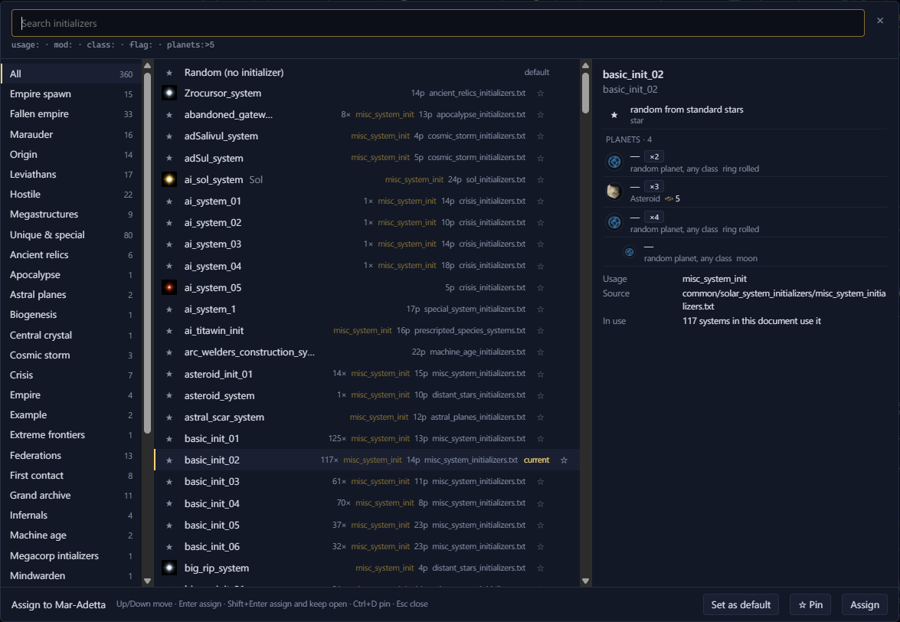

# Initializers <Badge type="info" text="Scenario" />

An initializer is a definition, from the game or a mod, of what a
system spawns: its star, its planets and anything else the game places
there.

## Choose a system's initializer

Select one or more systems and press <kbd>Shift</kbd>+<kbd>I</kbd> to
open the initializer browser. Pick an initializer to see what it places,
then click Assign to give it to the selected systems.

<Annotated :marks="[
  { n: 1, box: [15, 13, 1115, 36], label: 'Search, with the filter prefixes listed under it' },
  { n: 2, box: [2, 80, 185, 690], label: 'Groups' },
  { n: 3, box: [203, 80, 555, 690], label: 'Initializers, with how often each is used, its planet count and its file' },
  { n: 4, box: [775, 80, 400, 450], label: 'What the selected initializer places' },
  { n: 5, box: [918, 775, 240, 30], label: 'Set as default, Pin and Assign' }
]">

</Annotated>

Set as default makes the initializer the one a new system spawns from
when you right-click empty space and select "New system". Pin adds it to
the Pinned group at the top of the list, and <kbd>Ctrl</kbd>+<kbd>D</kbd>
does the same.

To add a new system from an initializer, see
[Add a system to a scenario](../edit/add-systems.md#add-a-system-to-a-scenario).
The [system view](../system/system-view.md#see-how-a-scenario-system-rolls)
shows what a system's initializer places, with an example roll where it
leaves things to chance.

## Filter the list

Type words to filter the list. An initializer shows only when it matches
every word. Use these prefixes to search one field:

| Filter | Matches |
| --- | --- |
| `usage:` | The initializer's usage, as its file writes it |
| `mod:` | The mod's name, or the file the initializer is in |
| `class:` | The star class, as the file writes it or the game names it |
| `flag:` | The initializer's flags |
| `planets:>5` | Initializers with more than 5 planets. `planets:<5` and `planets:5` work too. |

The [Initializer keys layer](../map/layers.md#every-layer) shows each
system's initializer on the map.

## Open a script in your editor

Galaxy Forge shows script text but doesn't change it. To edit a script,
open its file in your own editor at the line you're reading. The Open
file button sits in the Initializer section, beside each script on the
Scripts tab, on the Source tab of a scenario system, on a body's page and
in the header of each script snippet.

The first time you click it, Galaxy Forge asks which editor to use. It
lists the editors it finds on your computer: VS Code, VSCodium,
Notepad++, Sublime Text, JetBrains IDEs and Kate. "System default" opens
the file in the program your computer opens `.txt` files with. For
"Other…", click Browse… to pick the program, then type its arguments,
where `{file}` is the file and `{line}` the line.

With "Remember my choice" ticked, later files open straight away, and the
button names the editor, such as "Open in VS Code". Untick it to choose
each time. To change the editor or forget it, open the Help menu and
select "Change editor…" or "Forget editor".

Files of the game and of Workshop mods open too, but Steam replaces them
when the game or the mod updates, so changes you make there are lost.
The chooser and the status bar say so each time you open one. Copy the
file into a mod of your own before you edit it.

While a scenario has unsaved edits, its file on disk doesn't match what
you see, so the scenario's own file opens at the top. Save first to open
it at the line.

If the editor doesn't start, the file opens in the system default
instead, and the status bar says so.
