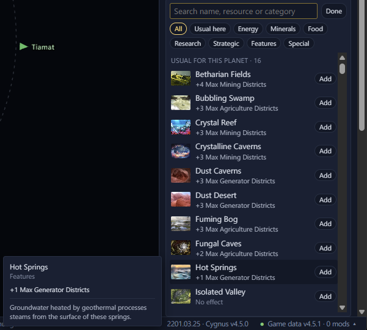

# Deposits and modifiers <Badge type="tip" text="Save" /> <Badge type="info" text="Scenario" />

These sections are on a [planet's page](planet-pages.md), below its
name, size and class.

## Add or remove a deposit

Deposits show with the game's own art, one row per type. Each row says
what the deposit yields, or what it does while unworked. The district
capacity they all add up to shows at the top of the section. A blocked
deposit shows a blocker mark, the tech and resources needed to clear
it, and how long clearing takes.

Remove a deposit with the ✕ on its row. To add one, click Add deposit
under the deposits. It lists every deposit type except blockers, which
have a list of their own. The ones the game places on that body come
first, under "Usual for this planet". Type to search by name, resource
or category, or pick a category chip. Special holds the deposits only
events place. Orbital deposits of one resource, such as +1 to +10
Energy, share a row: click an amount to add that one.

Add blocker, under the Blockers heading, works the same way for
blockers. Its chips pick the blockers a tech clears, the ones that need
no tech or can't be cleared, and Special for blockers that do more than
take away districts. The heading shows even when the body has none.

Both lists stay open until you click Done or press <kbd>Esc</kbd>. A
mining or research station over a removed deposit stays in game and
still costs about 1 energy a month.

The bottom of the deposit, blocker, modifier and archaeological site lists shows
the game's description of the row you hover over. Without the pointer
on a row, it describes the row the arrow keys are on.

## Change deposits on a colony

Colonised planets take deposit edits too. The game applies them on its
next monthly tick. When an edit may cost the colony districts,
buildings or a clearing in progress, the page warns you first. You then
click Remove anyway or Add anyway, or Cancel.

- Districts over a lowered cap are demolished. The save doesn't store
  the caps, so the page counts what the deposits give. It says "may"
  when something else adds to the cap too.
- A zone or building that needs the removed deposit goes, such as
  Crystal Mines without a rare crystals deposit, or the Xeno Zoo
  without Alien Pets.
- Removing a blocker that is being cleared cancels the clearing. What
  was spent on it isn't refunded.

When a planet finishes terraforming, the game changes its deposits,
including any you added.

## Add or remove a modifier

In a Stellaris 4.x save, the Modifiers section lists a planet's
features and timed modifiers, each with what it changes and how many
days are left. Remove one with the ✕ on its row. Add modifier, under
the list, lists the modifiers that act on a planet, its pops or its
jobs. Search by name or effect, or pick a chip: Features, Terraforming,
Positive, Negative or Other. Pick Permanent or a number of days before
you click Add. A timed modifier ends in game after that many days.
Adding or removing a timed modifier does what the console's
`add_modifier` and `remove_modifier` do. A planet feature also has a
line of its own, which is added and removed with it, as the game writes
a rolled feature.

With Gigastructural Engineering (Gigastructures), Add modifier also lists the Asteroid
Industrial Site Candidate modifiers for alloys, consumer goods, energy,
food and supertensiles. Add one to an asteroid to build that site there.

## What a scenario planet can roll <Badge type="info" text="Scenario" />

In a scenario, the Deposits and Modifiers sections list what the
initializer states. Under them, a heading such as "Can also roll · 3
resources" starts what the game can roll for the planet. When the
initializer states none, it reads "Can roll · 4 resources". A modifier
the initializer adds shows how long it lasts, such as "lasts 360 days"
or "permanent".

The deposits show as one bar per resource, likeliest first. Each row
starts with the resource's icon. A bar's length is how likely one roll
is to give that resource, and its percentage is at the right. The bar
is split by amount, from the smallest at the left to the largest at the
right. A lighter shade is a smaller amount, and wide enough parts show
their amount, such as "+2".

Hover over a row to see the resource's name, each amount with its
chance, and the deposits that give it. A deposit that yields nothing, such as a blocker,
has a plain bar of its own, with its name in place of an icon.

Where the class the planet rolls decides the odds, there are no bars.
When the initializer states no deposits, the Deposits row at the top of
the page reads "Suits its class", with a die. Click What it can roll under
it to open the list. It starts with "Depends on the class it gets."
Each resource is a chip with a dashed border, its icon and the amounts
it can give, such as "+1 to +3". Hover over a chip to see each amount
and the deposits that give it. The blockers are counted on one line,
such as "Blockers: 5 kinds", and deposits that give no resource on an
Other line. Hover over the count to see their names. When the
initializer states deposits too, the same list is in the Deposits
section, under "Can also roll".

Planet features are listed the same way, likeliest first, each with a
bar and its percentage. A percentage there is how likely the first
feature the game rolls is to be that one. Features with the same name
are listed once. Where none of the odds are known, the list starts with
"Depends on the class it gets." and the features show as one line of
names, under the Planet features row or in the Modifiers section. A
line of more than eight names ends with "+3 more", for example. Hover
over it to see all of them.

Where the initializer leaves nothing to roll, there is no list, and no
Deposits or Planet features row. A star with no planet features is one
example. Where the class the game picks decides the roll and Galaxy
Forge can't list it, the row or the section reads "Suits its class".

### See what one class rolls

When a scenario planet can roll several classes, its Class row lists
them under an Any button. Any is picked at first, and the page shows
what every class could give, as described above. Click a class's icon
or row to see the planet as that class. A line under the list reads
"If it rolls Toxic World", for example. The Size row shows that class's
range, and the Ring row shows its ring chance. The Deposits and
Modifiers sections list what the planet can roll as that class, as on
a planet whose class the initializer sets. Each shows a bar with its
percentage where Galaxy Forge can work out the odds, and only its name
where it can't.

Click Any, or the class again, to go back. Picking a class only changes
what the page shows. The scenario stays as it is. A star rolled from a
star list has the same buttons over its star classes.

## Make a planet a terraforming candidate

A barren, frozen, toxic or grey goo world's terraforming candidate
modifier is at the top of Add modifier, under "Usual for this planet".
With it, the planet can be terraformed once the empire has Climate
Restoration. Toxic worlds also need Detox. Frozen worlds also need
Hydrocentric and an aquatic species, and can only become ocean worlds.

## Add or remove an anomaly

In a Stellaris 4.x save, the Anomaly section shows the anomaly on a
planet, moon or star: its name, which empires have found it, and the
game's description of it. Remove it with the ✕ on its row. When it has
none, Add anomaly lists the anomalies you can add. Search by name, or
pick a level chip. The ones that can turn up on that body come first,
under "Usual for this planet". Some only turn up on stars, such as the
ones around pulsars and black holes. A body holds one anomaly, so the
list closes after you add one.

If you have surveyed the planet, the added anomaly shows in game right
away, ready for a science ship to research. If you haven't, it turns up
when you survey the planet. Anomalies that run their own script when
the game places them, such as precursor ones, aren't offered, because
the game wouldn't run that script. The AI's own anomalies aren't
offered either.

In an older save, a planet with an anomaly waiting on it shows an
Anomaly row in About: the anomaly's name, and which empires have found
it.

## Add or remove an archaeological site

In a Stellaris 4.x save, the Archaeological site section shows a planet's
archaeological site: its stage, its clues, whether a fleet is
excavating it, and the game's description of it. Remove it with the ✕.
A science ship excavating a removed site stops on the game's first day
and waits in orbit. A planet without a site has Add archaeological site. Search by
name, or pick Found by surveys or Event only. A planet holds one site,
so the list closes after an add. Sites that run a script when the game
creates them, such as Ruined Station and The Library, aren't listed,
because the game wouldn't run that script for an added site.
