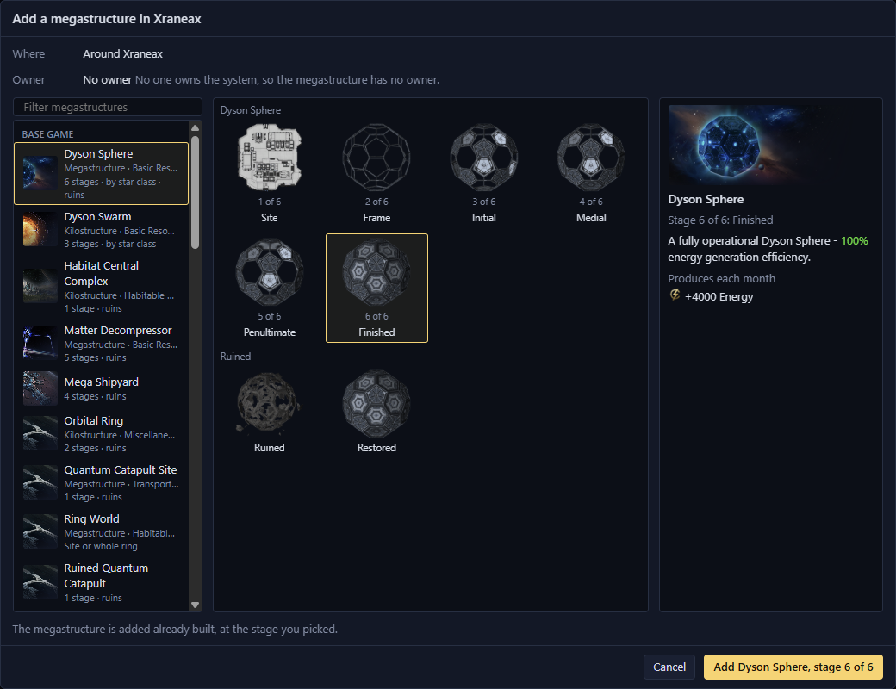
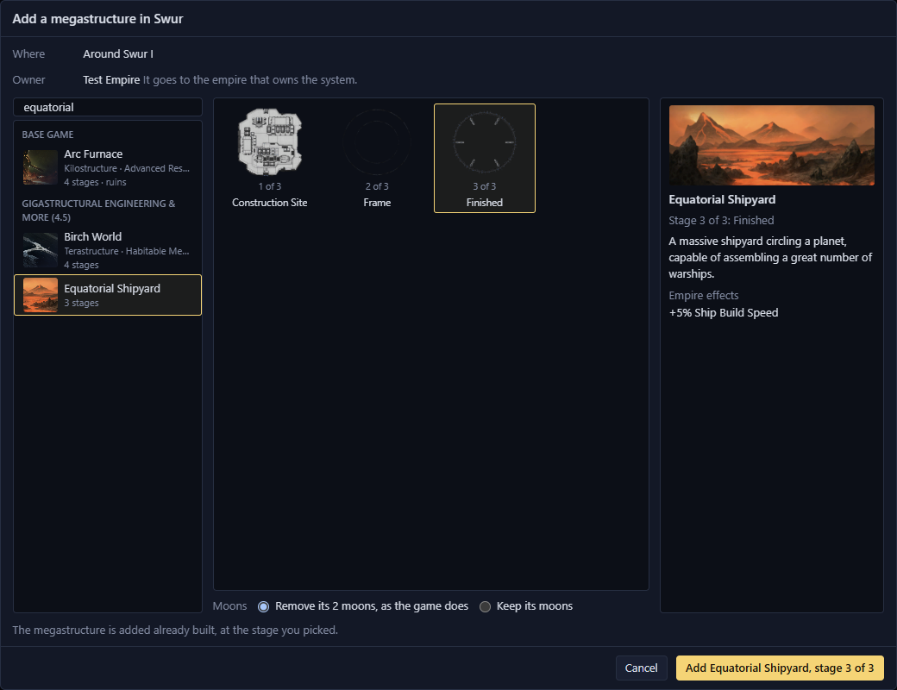
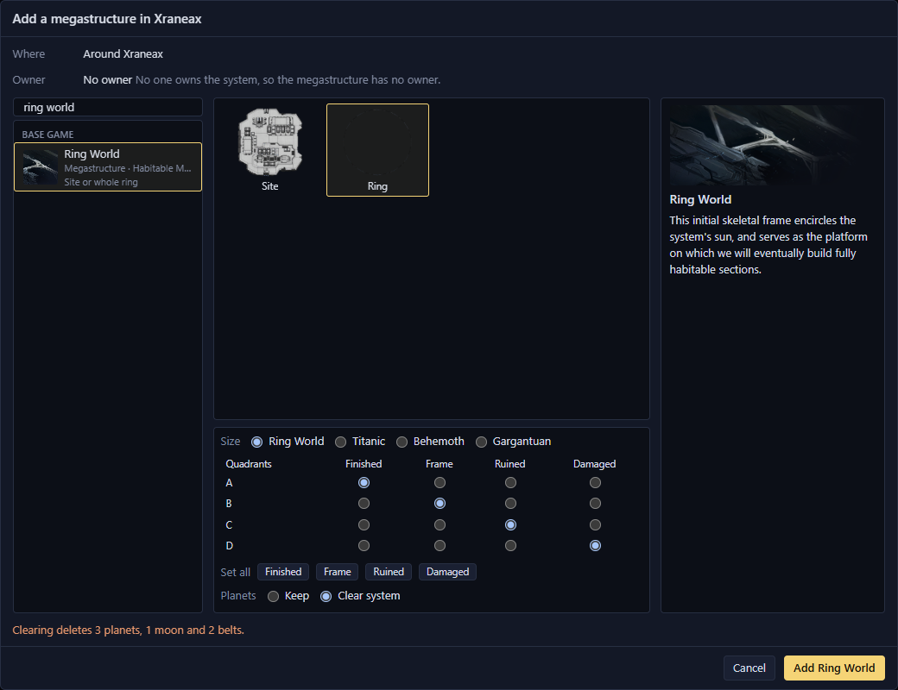
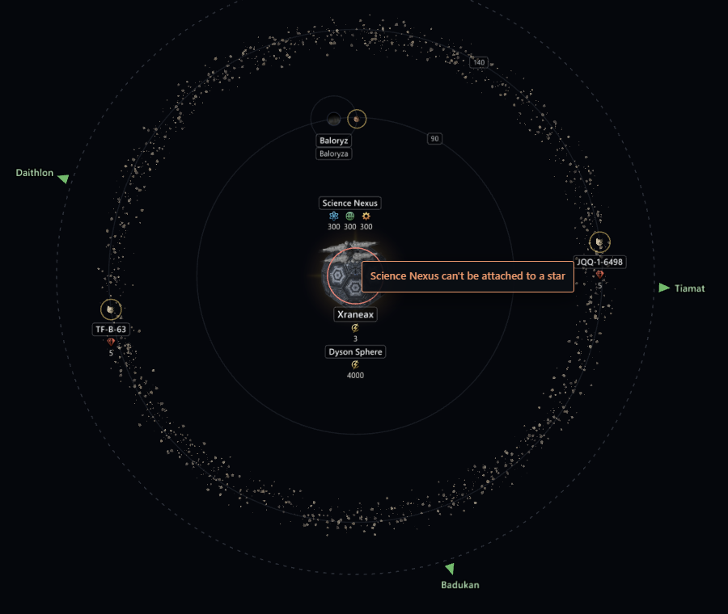

# Megastructures <Badge type="tip" text="Save" />

In a Stellaris 4.x save, you can add a megastructure already built, move
it within its system or delete it. You can also add habitats and
whole ring worlds. Adding needs the game data loaded.

In the [system view](system-view.md), each megastructure looks as it does
in the game.

## Add a megastructure

You can add any stage of the megastructures in the base game and your
enabled mods, ruins included.

1. Open the system in the system view.
2. Right-click where the megastructure goes:
   - For a Science Nexus, a Dyson Sphere or anything else built on a
     body, right-click the planet, moon or star and select Add
     megastructure.
   - For a Hyper Relay, a Gateway or an L-Gate, right-click empty space
     and select Add megastructure here.
3. Pick a megastructure from the list. Type in the box above the list to
   filter it.
4. Click a stage in the tiles beside the list.
5. Click the Add button.

<Annotated :marks="[
  { n: 1, box: [10, 108, 228, 610], label: 'The megastructures, with a filter above' },
  { n: 2, box: [244, 108, 512, 603], label: 'Its stages, ruins included' },
  { n: 3, box: [761, 108, 268, 603], label: 'The picked stage' },
  { n: 4, box: [812, 756, 216, 36], label: 'Add' }
]">

</Annotated>

The details beside the tiles show the stage as the game's construction
menu does, with its picture, description, monthly output and empire
effects. They also list the modifiers and deposits it adds.

The new megastructure's page opens in the Inspector. Press
<kbd>Ctrl</kbd>+<kbd>Z</kbd> to take it out again, with everything it
added.

With Gigastructural Engineering, a Dyson Sphere, a Matrioshka Brain and
the other megastructures that come in a version for each star class are
one entry each. Add picks the version for the class of the star you
right-clicked.

### Its effects and owner

- It comes with the modifiers and deposits that building it gives, such
  as an Arc Furnace's mining bonus or a Dyson Swarm's star modifier.
- It belongs to the empire that owns the system. In a system no one
  owns, it has no owner, so an Arc Furnace there adds no mining bonus.
- The game's other build effects don't happen. A Dyson Sphere doesn't
  freeze the system's planets.
- The status bar says how many effects Galaxy Forge left out, if any.

### Where each one goes

| Megastructure | Where |
| --- | --- |
| Dyson Sphere and others built round a star | A star only |
| Science Nexus, Arc Furnace and others built at a planet | A planet or moon, not a star |
| Hyper Relay, Gateway, L-Gate | Empty space, one of each per system |

A planet, moon or star holds one megastructure, plus any habitats. A
Hyper Relay links to the relays in the next systems, and a Gateway to
every other gateway. An L-Gate is added closed and links to the
L-Cluster when the L-Gates open.

### Megastructures that change their planet

Some megastructures change the class or size of their planet, such as
Gigastructural Engineering's Automated Strip Mine. The dialog then has a
Planet choice:

- Change to changes the planet as the game does. The dialog opens with
  this picked.
- Keep adds only the megastructure, and the planet keeps its class.

### Megastructures you can't add

Select a greyed-out megastructure to read why.

| Megastructure | Why |
| --- | --- |
| Alderson Disk and others that also build planets or sections | Greyed out, not supported yet |
| Planetary Computer and others that turn their planet into a special class | Greyed out, not supported yet |
| Deep Space Citadel, Nomad waystations | Not in the list, because they become a starbase |
| Later stages of the Quantum Catapult | Not in the list, not supported yet |
| Arkships, repaired Gigastructural Engineering warships | Not in the list, because they are ships. The wrecked warships are listed. |
| Galactic Crucible, Behemoth egg, Shroud Seal | Not in the list, because they are crisis and event structures |

## Add an Equatorial Shipyard

With Gigastructural Engineering, add an Equatorial Shipyard to a planet
as any other megastructure. Building one in the game removes the
planet's moons, so on a planet with moons the dialog has a Moons choice:

- Remove its moons, as the game does. The dialog opens with this picked.
- Keep its moons adds only the megastructure, and the moons stay.

Undo brings back any moons it removed.

## Add a habitat

1. Right-click a planet or star in the system view and select Add
   megastructure.
2. Pick Habitat Central Complex.
3. Click Add.

You get the finished habitat, orbiting where the game puts one. Its page
opens in the Inspector.

- It has no owner and no colony. Colonise it in the game.
- It has the habitat skin of the empire that owns the system.
- The restored Habitat Central Complex also adds the major orbital round
  the planet or star.
- You can add more than one habitat, or one round an asteroid or a black
  hole. You can't add one round a moon.

To delete a habitat, right-click it and select Delete planet. An orbital
it came with goes with the last habitat round that planet or star.

## Add a ring world

Clear system in step 5 deletes the system's planets, moons, belts and
colonies. The dialog opens with Keep picked.

1. Right-click the star in the system view and select Add megastructure.
2. Pick Ring World and click the Ring tile. The Site tile adds only the
   construction site.
3. With Gigastructural Engineering, pick a Size, from Ring World up to
   Gargantuan.
4. Pick a stage for each quadrant, A to D, or give them all one stage
   with Set all.
5. Under Planets, pick Keep or Clear system. With Clear system, the line
   above the button lists what goes.
6. Click Add Ring World.

<Annotated :marks="[
  { n: 2, box: [374, 116, 126, 116], label: 'The Ring tile' },
  { n: 3, box: [248, 504, 504, 26], label: 'Size' },
  { n: 4, box: [248, 530, 504, 150], label: 'A stage for each quadrant' },
  { n: 5, box: [248, 682, 240, 26], label: 'Keep or Clear system' }
]">

</Annotated>

| Stage | What you get |
| --- | --- |
| Finished | Ring sections with no colony. Colonise them in the game. |
| Frame | The frame the game builds before the sections |
| Ruined | A ruined section |
| Damaged | Damaged sections. The larger Gigastructural Engineering rings have none. |

- A ring world needs a system with one star.
- Rings of different sizes can share a system, and you don't have to
  add the smaller one first.
- Clear system is off when a starbase orbits a planet it would delete.

Undo brings back everything it cleared.

## Move within a system

Drag a megastructure in the system view. Hover over it first to see how
it moves, or why it stays where it is.

| Megastructure | How it moves |
| --- | --- |
| Hyper Relay, Gateway, L-Gate | Anywhere in the system. <kbd>Shift</kbd> snaps the angle to 15° steps. |
| Science Nexus and others beside their planet | Anywhere, and it still moves with its planet. To put it back, right-click it and select the Snap to item for its planet. |
| Orbital Ring, Arc Furnace, Dyson Sphere and others round their planet or star | Drop it on another planet, moon or star. Dropped anywhere else, it goes back. |

While you drag, the planets, moons and stars it can go to are ringed. A
red ring means that one can't take it, and the status bar says why.

The modifiers and deposits it added stay where they were. Ring world
sections, Quantum Catapults and parts of a larger structure, such as an
Equatorial Shipyard, can't be moved.

## Delete a megastructure

To remove a megastructure, right-click it in the system view and select
Delete megastructure, or click the button at the bottom of its page.
Galaxy Forge asks first, and one undo puts it all back.

- The modifiers and deposits it added go with it, as when it is
  dismantled in the game. Load the game data first, or they stay.
- Relay and gateway links go with it.
- Its planet stays, with any colony, and can take a new
  megastructure, such as a new Orbital Ring in place of a ruined one.
- Deleting a Cosmogenesis World, or another megastructure that made its
  planet, also removes the colony there. The confirmation lists it.
- Anything else it did stays. Planets a Dyson Sphere froze stay frozen.

An L-Gate the save already had can't be deleted, and the menu says why.

## Delete a ring world

Right-click any section of the ring, ruined or not, and select Delete
ring world. The whole ring goes, because a single section can't be
deleted.

- The confirmation lists the planets that go and any colonies on them.
- Other planets in the system stay, such as the Interloper beside a
  shattered ring.
- One undo puts the whole ring back.
