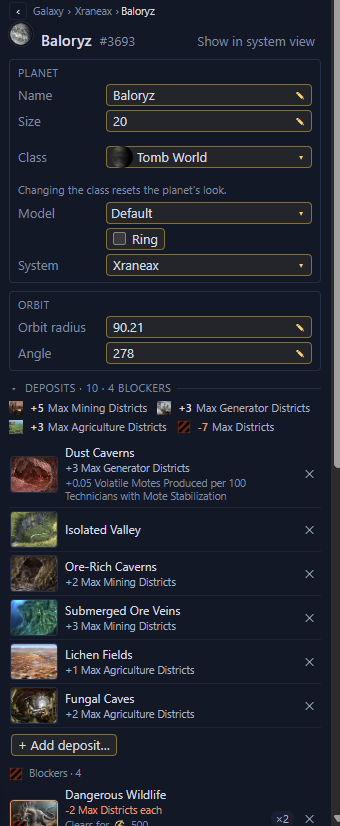

# Planet pages <Badge type="tip" text="Save" />

Click a body in a system's Planets list, or a moon in a body's own Moons
list, to open its page in the Inspector. In a save,
[search](../map/search.md) finds a planet by name too.

A star's page opens with its type and size to edit, as
[Stars](../edit/stars.md) describes. Moons are listed below a planet and
open their own pages the same way.

<Annotated :marks="[
  { n: 1, box: [8, 86, 330, 85], label: 'Name, size and class' },
  { n: 2, box: [8, 203, 330, 47], label: 'Model and ring' },
  { n: 3, box: [8, 255, 330, 22], label: 'The system it is in' },
  { n: 4, box: [8, 298, 330, 70], label: 'Orbit radius and angle' },
  { n: 5, box: [8, 388, 330, 340], label: 'Deposits and blockers' },
  { n: 6, box: [10, 736, 110, 24], label: 'Add deposit…' }
]">

</Annotated>

## Rename a planet or moon

Rename a planet or moon in its Name field. Moons named after a planet
take its new name too.

## Change a planet's size

Change a planet's or moon's size in its Size field. On a colony, the
game demolishes districts over a lowered cap within a month.

## Change a planet's look

In a Stellaris 4.x save, change a planet's or moon's look in its Model
field, such as the Ocean Paradise, Earth or Previously Terraformed
look. The looks the game uses on the planet's class come first.
Select Default to go back to the look of the planet's class. Terraforming
or any other class change in game also resets the look.

## Change a planet's class

In a Stellaris 4.x save, change a planet's or moon's class in its
Class field. Deposits, modifiers and any colony stay as they are. The
planet takes the new class's look, and the Model field can set
another. A colonised planet can only change to another habitable class with
ordinary districts, such as continental, ocean or tomb world. Stars,
habitats, ring worlds, arks and other special worlds keep their class.

## Add or remove a ring

In a Stellaris 4.x save, a planet has a Ring checkbox to give it a
ring or take its ring away. A moon only has the checkbox while it has
a ring, so you can take it off.

## A scenario body's page <Badge type="info" text="Scenario" />

In a scenario, a body's page shows what its initializer says about it.
It has the Name, Class, Size, Ring and Model rows, each set by the
initializer, rolled by the game or decided when a new game starts. A
value with a dotted underline has more to say. Hover over it to see the
explanation. A line under the name says when some games don't have the
body, and how many bodies like it the game places. The page also lists
the deposits, modifiers, anomaly and flags the initializer states. A
start planet has a "start planet" mark beside its name, and a home
planet a "home planet" mark. A Stopped row lists what the initializer
stops on the body, such as Blockers, Planet features or Anomaly. The
Initializer section shows Script at game start, the lines the game runs
for the body, and Other initializer lines. Nothing on the page can be
edited yet.

Where only the class the body gets decides its model, ring, deposits or
planet features, that row reads "Rolled to suit its class". Under the
Deposits and Planet features rows, click What it can roll to see what
the class could give. It starts closed.

An unnamed body shows the name the game gives it, made from the
system's name, such as "Yunak II" or "Yunak IIa". The game numbers
planets in order. Where some bodies before it may not be placed, the
name is rolled, and the line under it lists every name it can have.
Lists, links and the system view show the first name it can have, such
as "Yunak II". A row of the Planets list that stands for several
planets shows the names they can have, such as "Yunak II to IV".
Asteroids get names the game draws at random, and their Name row reads
"Random".

A rolled class lists the classes that fit the body's orbit, likeliest
first. Where the orbit is a single distance and the system's star is
fixed, each class has a bar and its odds, and the likeliest class's bar
is the longest. A class picked from a named list of
classes lists every class in the list. The game may roll any of them,
even one that doesn't fit the orbit. More than four classes without odds
show as a row of icons. Hover over an icon to see the class's name. A
rolled ring shows its chance.

Some bodies are never placed, because none of the classes they can roll
fit their orbit. They show "never placed" on their row and their page,
and look faint in the system view. A moon of a planet that is never
placed is never placed either. A row of several planets counts only the
ones the game can place.

Some bodies are only placed in some games. Where a body can land at
several distances, or the system's star is rolled, no class may fit in
some of those cases, and then the game leaves the body out.

## Go back

Use the breadcrumb above the page to go back. Click "‹" to go back one
step, a name in it to go to that page, or "Galaxy" for the Galaxy page.

Deposits, modifiers, anomalies and dig sites are on
[Deposits and modifiers](deposits-and-modifiers.md). A planet's colony
is on [Colonies and deleting planets](colonies.md).
