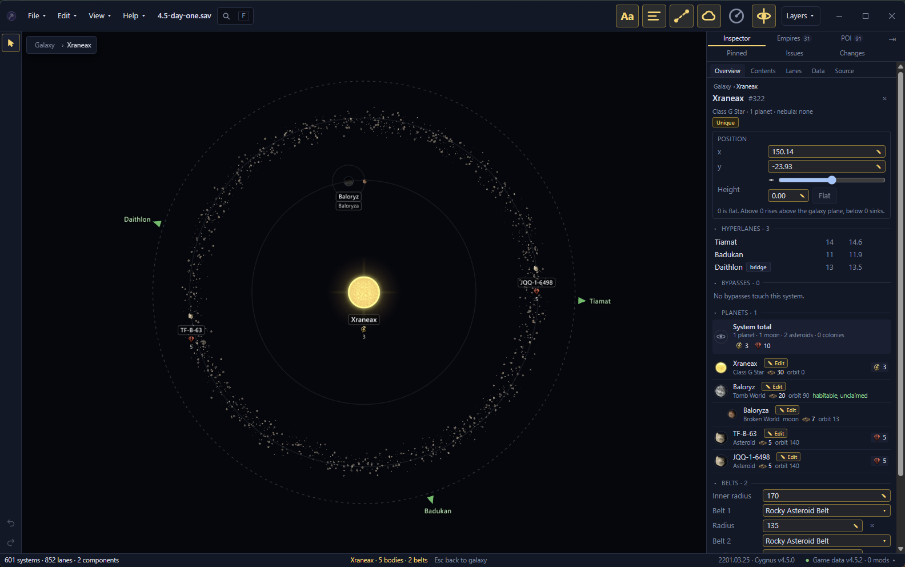
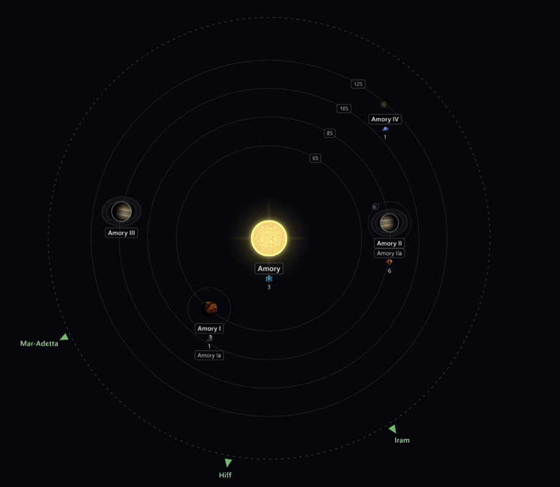
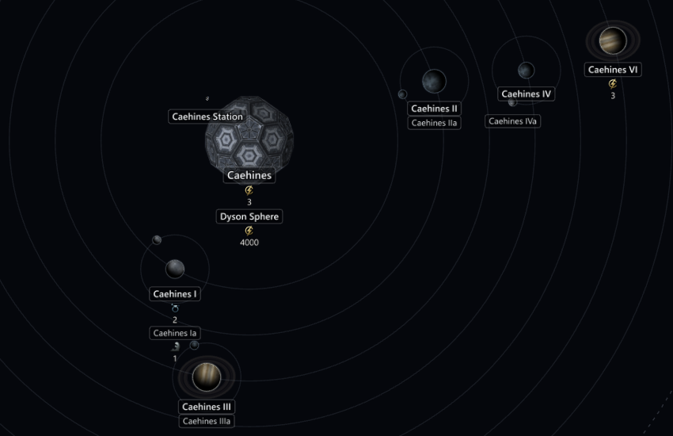

# System view <Badge type="tip" text="Save" /> <Badge type="info" text="Scenario" />

Open one system to see its star, planets, moons and asteroid belts laid
out as they are in the game.

## Open a system

To open a system:

- Double-click the system on the map.
- Select the system and press <kbd>Enter</kbd> or <kbd>M</kbd>.
- Right-click the system and select Open system view.
- Click Show in system view in the Planets header of the system's page.
- Select the system and use View → Open system view.

Each body sits on its orbit around the star, or around its planet for a
moon. Hyperlanes show as arrows at the edge, pointing to the
neighbouring systems. Click an arrow to see the lane's length.
Double-click it to open that neighbour's view. Scroll to zoom and drag
with the middle mouse button to pan, as on the galaxy map. A large save
can take a moment to read a system, and the status bar says "Reading the
system…" until the bodies appear.

The status bar counts the system's bodies and belts. With a body's page
open in the Inspector, it shows that body's orbit and angle.

## See how a scenario system rolls <Badge type="info" text="Scenario" />

Systems in a scenario open the same way and show what their
[initializer](../scenario/initializers.md) sets. Where it leaves an orbit
or an angle to chance, the view shows one possible layout. Click Roll
again next to the system's name, or use View → Roll again, to see
another. A random planet class shows a question mark.

Select a scenario body to see its ranges. The band is the range its
distance can fall in, and the wedge is the range of its angle. The body
or orbit that the distance and angle are measured from is outlined in
blue. The body's page lists its orbit step, its angle step and whether
it has a ring. Click the name in the angle step to go to the body it
turns from.

A small dial before the angle step shows the turn as the system view
does. The dot on its rim is the body it turns from. A shaded wedge is
the range of angles it can stand at, and a line to a dot is a fixed
turn. A fully shaded dial means any angle. There is no dial where a
variable sets the turn.

Some blocks of an initializer place a range of planets, such as 2 to
10. The view draws every planet the block can place. The ones past the
lowest count have a dashed halo, because the game may not place them.

A scenario system whose initializer is `random`, missing or unknown to
your install gets its planets rolled when the game starts. An
initializer that places its planets only through a script works the
same way. The view shows faint placeholder planets for such a system,
rolled by the game's rules for its star. The game rolls its own planets
at the start, so they won't match the placeholders. You can't select
the placeholders.

## Rolled values and how many planets spawn <Badge type="info" text="Scenario" />

The system's page in the Inspector shows what the initializer places,
in the same sections a save's page has. The line under the name counts
planets only, as it does for a save. Moons and asteroids are counted in
the System total row at the top of the Planets section. A count the game rolls shows as a range, such as
"2 to 10 planets".

Values show in one of three ways:

- A value the initializer sets shows as plain text, as in a save.
- A value the game rolls when a new game starts shows in blue after a
  small die. Hover over the die to see "Rolled when a new game starts".
- A value the game decides in a way Galaxy Forge can't show is in grey
  italics with a question mark.

A value with a dotted underline has an explanation. Hover over it to
read it. It says, for example, why the game decides a class when a new
game starts or which variable sets a size. Ranges read "10 to 20".

Some initializers place a planet a random number of times. The Planets
list shows those planets as one row, such as "Random planets", with the
count at the right, such as "1 to 4". Hover over the count to see what
it means. Click the row to open the first of them. A planet that may not
spawn, because some games don't have it, shows "0 to 1". The system view still
shows every planet the game can place, with a dashed ring on the ones
not every game has. A star drawn from a star list has a Star class
section that lists the list's star classes, likeliest first. Each has a
bar in the star's colour and its odds.

## A scenario system's Initializer section <Badge type="info" text="Scenario" />

The Initializer section starts with the initializer's name and the
Change… button, or Choose… on a system that has no initializer. Under it are the kind of system it makes and the file
it comes from. Click Open file to open that file in your editor at the
initializer's line, or Show in folder to find it. Once you've picked an
editor, the button names it, such as "Open in VS Code". Galaxy Forge
doesn't change the file.

The rows below say which empire or creature the initializer creates,
how many of these systems a galaxy can have, and which values come from
a variable or an inline script. Three groups follow:

- Script at game start lists the lines the game runs once, when a new
  game starts. On a scenario map they run before hyperlanes exist. Where
  a line looks for a neighbouring system, a warning says it finds none.
- Random galaxy settings are the keys a random galaxy uses to decide how
  often to add the system. Your map already places it, so they have no
  effect. This group starts closed.
- Other initializer lines lists the lines Galaxy Forge keeps as written
  but doesn't show elsewhere.

Click a group's heading to open or close it. Script text shows as the file
writes it, in the colours of the CWTools extension for VS Code. Click
"Show all" under a long piece to see the rest.

The Source tab shows the system's own text, laid out one line per key
as in a game file. Your file keeps its own layout. Text an edit changed
is highlighted, with a bar at the left of its line.

Under the system's text, the Source tab shows its initializer as the
file writes it, with the file's name above it. Each `inline_script` line
ends with the script's name. Click the name to open that script in your
editor.

A planet's or moon's page has a Source tab too. It shows the same
initializer with a bar beside the block that places the body. For a
body that comes from an inline script, the bar marks the
`inline_script` line.

Nothing on a scenario system's page can be edited yet.

## Show orbit radii

Press <kbd>2</kbd> in a system view to turn on Orbit radii. Each orbit
shows its radius. The selected body always shows a line out to it with
its radius.

## Megastructures and starbases <Badge type="tip" text="Save" /> <Badge type="info" text="Scenario" />

Each megastructure and starbase in a system shows as its model from the
game, at the size it has in game. A Dyson Sphere covers
its star, and an Arc Furnace rings its planet. A megastructure built on
a planet or moon stays with it when you move the planet. Ring world
sections turn to face their star, so the pieces of a ring world join up.

Habitats and ring world sections are planets, and they show as their
models from the game too. You select, move and name them as you do any
other planet. To add a habitat, see
[Add a habitat](megastructures.md#add-a-habitat). To add a ring world
with its sections, see
[Add a ring world](megastructures.md#add-a-ring-world).

Each megastructure and starbase shows its name on a plate under it
while Names is on. One that covers a star or a planet, such as a Dyson
Sphere or an Arc Furnace, has its plate under that star's or planet's plate. With System details on, a megastructure that
produces resources, such as a Dyson Sphere or a Science Nexus, shows
what it produces each month under its name. This is the base output,
before your empire's modifiers, so the game can show a different figure.

Hover over a megastructure or starbase to see its name. Click its model
to open its page in the Inspector. To select a planet or star under a
megastructure, click the planet or star itself or its name plate.

Right-click a megastructure to inspect it or delete it. See
[Delete a megastructure](megastructures.md#delete-a-megastructure).

The models are read from your Stellaris install. Galaxy Forge prepares
them in the background after a save opens. A system you open straight
away can take a moment to show them. A megastructure from a mod you
don't have installed shows the game's megastructure icon instead.

Press <kbd>7</kbd> in a system view to hide them, or turn off
Megastructures and starbases in the Layers menu.

To add a megastructure, right-click a body or empty space. See
[Add a megastructure](megastructures.md#add-a-megastructure).

### In a scenario <Badge type="info" text="Scenario" />

A scenario system shows the megastructures and the starbase its
[initializer](../scenario/initializers.md) places, where the game puts
them when a new game starts. You need the game data loaded.

- A megastructure placed at a planet sits on that planet. Click Roll
  again and it moves with the planet.
- A megastructure placed at a distance and angle from the star sits
  at that point, such as the ruined ring world sections in a fallen
  empire's home system.
- The starbase sits beside the star, where the game puts a system's
  first starbase.
- A megastructure or starbase the game may not place has a dashed halo.
  That covers one the initializer places only under a condition, and
  one on a planet the game may not place.
- The game places some ruins, such as a ruined gateway or a ruined
  Hyper Relay, at random when the game starts. Each shows faint at a
  typical spot, with "placed at random" after its name. A relay sits
  just outside the inner radius, and a gateway halfway between the inner
  and outer radius. You can't select these.

Models show without an empire's look, because a scenario's empires
have no graphical culture. A fallen empire's ring world sections belong
to the fallen empire, as they do in a new game.

You can't open the page of a scenario's megastructure or starbase, and
you can't edit them. The system's page lists them in its Megastructures
and Station sections.

## Names and layers in a system

Each body's name sits on a plate under it. A colonised planet's plate
has a bar in its owner's colour. Names, System details, Nebulae,
Megastructures and starbases and, in a save, Bypasses still work while
a system is open, with their own settings, so you can have them on in
the galaxy and off in a system.
With System details on, each body's resources show under its name. A
colony's name shows its owner's flag. A body's name also shows icons
for its archaeological site, anomaly and pre-FTL civilisation. While
Megastructures and starbases is off, it shows an icon for its
megastructures too.
Hover over an icon or a resource to see what it is. A system inside a
nebula shows faint clouds behind it while Nebulae is on. The other
layer buttons and the tool strip are for the galaxy, so they are hidden
while a system is open. Undo and redo still work from the Edit menu and
their keys.

## Go back to the galaxy

Press <kbd>M</kbd>, click "Galaxy" in the breadcrumb at the top left of
the map, right-click and select Back to galaxy, or use View → Back to
galaxy. <kbd>Esc</kbd> and <kbd>Backspace</kbd> go back too once the
Inspector has no page left to step back from. The galaxy map is where
you left it.
